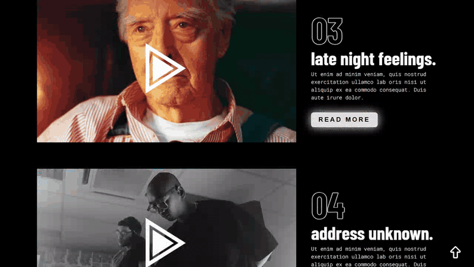
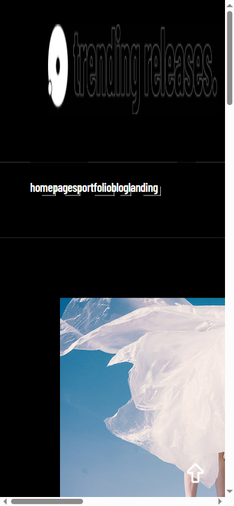
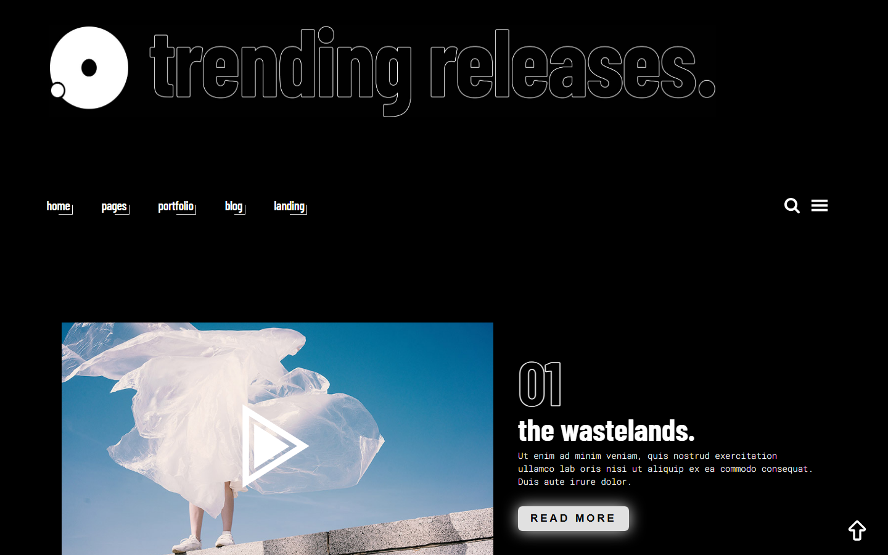
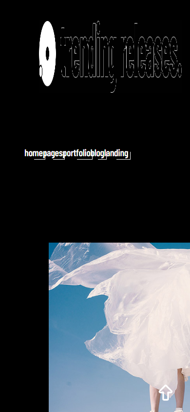

# Leitmotif — Film Trailers Site

A poster-driven landing page for a fictional film trailer platform, rebuilt around its own cinematic identity: projection-black surfaces, editorial letterboxed frames, and type doing the heavy lifting.

**Live demo:** https://film-website-mister2314.vercel.app/

<div align="center">



| Desktop | Mobile |
|---|---|
|  |  |

<details>
<summary>More screenshots</summary>

| Desktop | Mobile |
|---|---|
|  |  |

</details>

</div>

## What it is

Five trailers, five full-bleed stills. Each film is a letterboxed 16:9 frame beside an editorial text column: a giant outlined index numeral, a condensed headline, and a mono metadata row (year · cut · platform). Hover a frame and the letterbox bars slide in from top and bottom, the still breathes to 1.04×, and a play glyph fades up under a faint marquee-amber glow. On touch devices the composition drops to a single column with the metadata always visible — no hover tax.

## Tech stack

React 19 · TypeScript · Vite — zero runtime animation libraries. All motion is CSS transitions with three easing curves: `expo.out` for arrivals, a short state ease for hovers, linear for the letterbox bars.

## Features

- **Letterbox hover choreography** — cinema bars, image scale and play glyph on `pointer: fine` devices only
- **Lazy media pipeline** — every still is `loading="lazy"` + `decoding="async"` with explicit dimensions (no CLS); only the hero logo loads eagerly with `fetchpriority="high"`
- **Mobile as its own composition** — single column, full-bleed frames, no fixed-viewport heights, no horizontal scroll at 390 px
- **Keyboard-first film index** — skip link, amber focus outlines, and descriptive labels ("Trailer 03: late night feelings — watch on YouTube, opens in a new tab")
- **Reduced-motion fallback** — under `prefers-reduced-motion` the static page is the complete page: bars stay drawn, play glyphs stay visible, transitions collapse to zero
- **Real copy** — every film carries its own one-line blurb and metadata instead of placeholder text

## Accessibility

Contrast-checked palette (`#f2efe6` on `#0a0a0c` ≈ 15:1), labelled controls, decorative SVGs hidden from the tree, email field with a real label, and visible focus states on every interactive element.

## Run locally

```bash
git clone https://github.com/Mister2314/Film-Website.git
cd Film-Website
npm install
npm run dev
```

## Build

```bash
npm run build   # tsc -b && vite build
npm run preview
```
