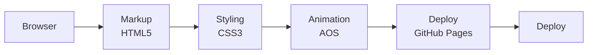

<h1 align="center">Leitmotif — Film Trailers Site</h1>

<p align="center"><b>A film trailer site with a poster grid and condensed editorial typography.</b></p>

<p align="center">
<a href="https://mister2314.github.io/Film-Website/"></a>


</p>

<p align="center"><a href="https://mister2314.github.io/Film-Website/"><b>Live demo</b></a> &nbsp;·&nbsp; <a href="#quick-start">Quick start</a> &nbsp;·&nbsp; <a href="#features">Features</a> &nbsp;·&nbsp; <a href="#architecture">Architecture</a> &nbsp;·&nbsp; <a href="#faq">FAQ</a></p>

<p align="center">
  <a href="https://mister2314.github.io/Film-Website/">
    
  </a>
</p>

<p align="center"><sub>Live capture of the real build — 2437 KB, loops forever.</sub></p>

## Overview

A cinematic site for a fictional trailer platform. The layout is poster-driven: a logo hero, a navigation bar, and grids of film stills arranged to read like a programme.

The type pairing — Barlow Condensed for headings against Roboto Mono for detail text — does the editorial work, and AOS brings the grids in as the page scrolls.

## At a glance

| Field | Detail |
| --- | --- |
| **Type** | Static site — no build step |
| **Primary language** | HTML |
| **Live demo** | [mister2314.github.io/Film-Website](https://mister2314.github.io/Film-Website/) |
| **Repository** | [Mister2314/Film-Website](https://github.com/Mister2314/Film-Website) |

## Features

- Logo hero and top navigation
- Poster and still-image grids
- Barlow Condensed / Roboto Mono type pairing
- AOS scroll-in animations
- Responsive image grids that reflow on mobile

## Tech Stack

| Layer | Technology |
| --- | --- |
| Markup | HTML5 |
| Styling | CSS3 |
| Animation | AOS |
| Deploy | GitHub Pages |

## Architecture



## Screenshots

| Desktop | Mobile |
| :---: | :---: |
|  |  |

## Quick Start

```bash
git clone https://github.com/Mister2314/Film-Website.git
cd Film-Website

# open it directly
start index.html      # Windows
open  index.html      # macOS

# or serve the folder
npx serve .
```

## Project Structure

```
index.html — hero, navigation and poster grids
assets/css/style.css — layout and typography
assets/img/ — poster and still imagery
```

## FAQ

<details>
<summary><b>What is Leitmotif?</b></summary>

A fictional trailer platform. The page exists to practise poster-driven layout — grids of stills arranged to read like a printed programme.

</details>

<details>
<summary><b>Why Barlow Condensed with Roboto Mono?</b></summary>

A condensed face for headlines and a mono for detail text is the standard editorial pairing. It does the work that imagery would otherwise have to.

</details>

<details>
<summary><b>Is there any video?</b></summary>

No. Despite the subject, the page is entirely stills — which was the constraint I set myself.

</details>

## Roadmap

- [ ] Add real trailer embeds
- [ ] Make the poster grids keyboard-navigable
- [ ] Compress the still images

## Author

**Xəyal Hüseynli** — Junior Front-End Developer

[Portfolio](https://hypnosdev.vercel.app) · [GitHub](https://github.com/Mister2314) · [LinkedIn](https://www.linkedin.com/in/x%C9%99yal-h%C3%BCseynli-3487b91ba/) · [xeyalhuseynli06@gmail.com](mailto:xeyalhuseynli06@gmail.com)
